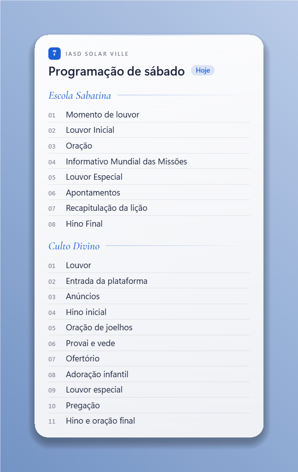
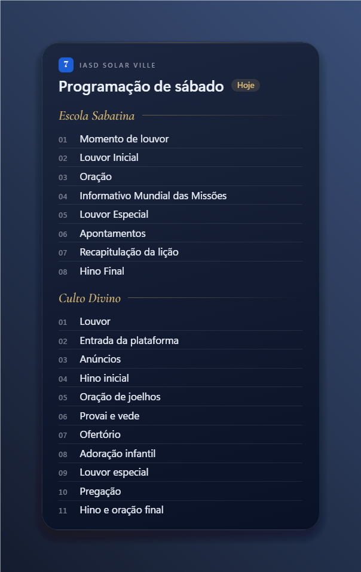
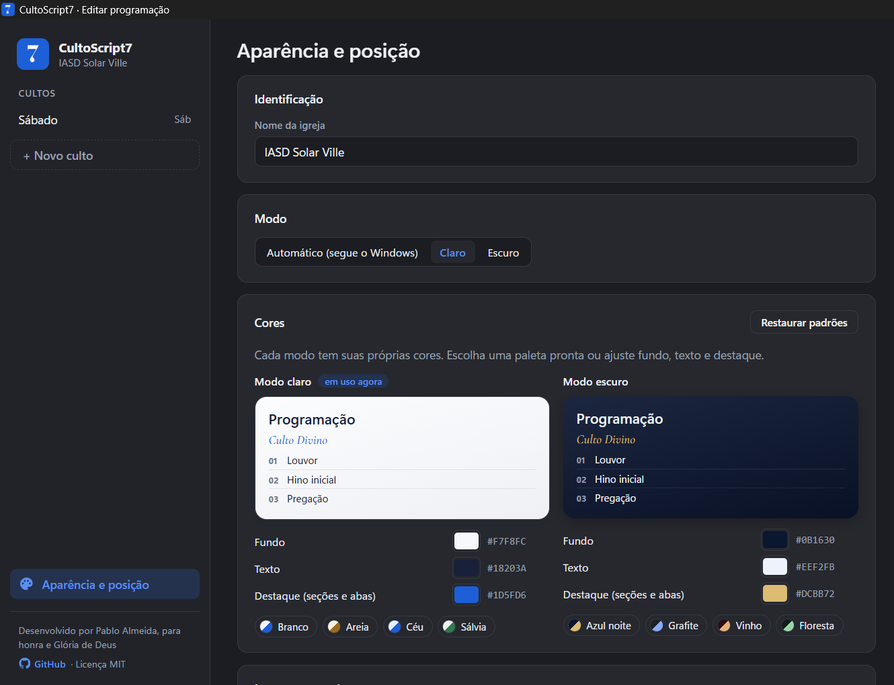

<p align="center">
  
</p>

<h1 align="center">CultoScript7</h1>

<p align="center">
  A programação do culto sempre à vista, direto na área de trabalho do Windows.
</p>

<p align="center">
  
  &nbsp;&nbsp;
  
</p>

---

O **CultoScript7** é um widget para Windows 10 e 11 que mostra as etapas do culto na área de trabalho, numa janelinha discreta e elegante. Foi feito para a equipe de som, mídia e plataforma acompanhar a liturgia sem precisar de papel nem trocar de janela.

Nasceu na IASD Solar Ville e está disponível de graça para **qualquer igreja** usar e adaptar.

## Recursos

- **Fica na área de trabalho**: sempre atrás das outras janelas, sem ícone na barra de tarefas e sem botões de fechar ou minimizar.
- **Vários cultos em abas**: sábado, domingo, quarta-feira… O widget abre sozinho no culto do dia (ou no próximo da semana).
- **Editor simples**: crie seções (ex.: *Escola Sabatina*, *Culto Divino*) e etapas, reordene e exclua. Tudo é salvo automaticamente.
- **Modo claro e escuro**: automático (segue o Windows) ou fixo, com cores personalizáveis e paletas prontas.
- **Ajustável**: largura, tamanho do texto, opacidade do fundo e seções em uma ou duas colunas.
- **Inicia com o Windows** e fica disponível pelo ícone **7** perto do relógio.
- **Funciona offline**: não precisa de internet nem de conta.

## Instalação

1. Acesse a página de **[Releases](https://github.com/pablomalmeida777/CultoScript7/releases/latest)** e baixe o `CultoScript7-Setup.exe`.
2. Abra o instalador e siga os passos. Ele instala em *Arquivos de Programas* e cria o atalho **CultoScript7** no Menu Iniciar (e, se quiser, na área de trabalho).
3. Na última tela, deixe marcado **Abrir o CultoScript7 agora**. O widget aparece no canto superior direito da tela e, a partir daí, inicia junto com o Windows.

**O Windows mostrou "O Windows protegeu o computador"?** Isso acontece com programas novos que ainda não têm assinatura digital. Clique em **Mais informações → Executar assim mesmo**.

**Requisitos:** Windows 10 ou 11 (64 bits). Se faltar o Microsoft Edge WebView2 (comum só em Windows 10 desatualizado), o instalador cuida disso.

## Como usar

| Para… | Faça |
|---|---|
| Abrir o menu | Clique no ícone **7** perto do relógio. Se não aparecer, procure na setinha **^** de ícones ocultos. |
| Editar a programação | Abra **CultoScript7** no Menu Iniciar, ou Menu do ícone → **Editar programação**. |
| Mudar o widget de lugar | Com o editor aberto, arraste o widget pela área de trabalho. A posição é salva ao soltar. |
| Trocar o nome da igreja, as cores ou o tamanho | No editor, abra **Configurações**. |
| Adicionar o culto de domingo ou quarta | No editor, clique em **+ Novo culto**. |
| Fazer backup ou levar para outro PC | No editor, **Configurações → Exportar cultos…** / **Importar cultos…** |
| Fechar o app | Menu → **Fechar CultoScript7**. Ele volta a abrir no próximo login. |

**Atalhos no editor:** `Enter` cria a próxima etapa · `Backspace` numa etapa vazia apaga a linha · `Alt + ↑/↓` muda a etapa de posição · `↑/↓` navega entre as etapas.

<p align="center">
  
</p>

### Primeira vez em outra igreja

O app vem com uma programação de sábado de exemplo (Escola Sabatina e Culto Divino) e o nome "Minha Igreja". Para adaptar:

1. Abra o editor e, em **Configurações**, troque o **Nome da igreja**.
2. Volte ao culto de **Sábado** e ajuste as seções e etapas.
3. Se quiser, crie abas para os outros cultos da semana.

### Backup, outro computador ou outra igreja

Em **Configurações → Exportar e importar cultos**:

- **Exportar cultos…** salva todos os cultos num arquivo `.json`, no lugar que você escolher (pen drive, OneDrive, e-mail…).
- **Importar cultos…** carrega esse arquivo em outro computador ou depois de reinstalar. A importação **substitui os cultos atuais**; o nome da igreja, as cores e a posição do widget não mudam.

Também dá para compartilhar a programação com outra igreja: ela importa o seu arquivo e ajusta o que precisar.

### Desinstalar

Em **Configurações do Windows → Aplicativos → Aplicativos instalados**, procure **CultoScript7** e clique em **Desinstalar**. O desinstalador pergunta se você quer apagar também a programação salva. Escolha *Não* se for reinstalar.

---

## Para desenvolvedores

Feito em **Go** com **[Wails v3](https://v3.wails.io)**. A interface é HTML, CSS e JavaScript puros, sem Node e sem etapa de build no frontend.

### Compilar

Pré-requisitos: [Go 1.25+](https://go.dev/dl/) e a CLI do Wails v3:

```powershell
go install github.com/wailsapp/wails/v3/cmd/wails3@latest
```

Depois, na raiz do projeto:

```powershell
.\build.ps1              # gera bin\CultoScript7.exe
.\build.ps1 -Icones      # também regenera os ícones
.\build.ps1 -Instalador  # também gera bin\CultoScript7-Setup.exe (requer NSIS: winget install NSIS.NSIS)
```

### Publicar uma versão

O build oficial é feito pelo GitHub Actions ([`.github/workflows/release.yml`](.github/workflows/release.yml)):

1. Em **Releases → Draft a new release**, crie uma tag no formato `v1.2.3` e publique.
2. O workflow compila o app e o instalador no Windows, com a versão tirada da tag, e anexa o `CultoScript7-Setup.exe` à Release.

A assinatura de código é feita pela [SignPath Foundation](https://signpath.org) quando as credenciais estão configuradas no repositório (veja o topo do workflow). Sem elas, o instalador é publicado sem assinatura.

### Estrutura

```
main.go               app, janelas, bandeja e métodos chamados pelo JavaScript
config.go             modelo de dados e gravação em %APPDATA%\CultoScript7\config.json
backup.go             exportar/importar cultos (.json)
desktop_windows.go    Win32: prende o widget à área de trabalho e ajusta o menu da bandeja
migrar_windows.go     migração da versão com o nome antigo (CultoScript)
frontend/             widget (widget.*) e editor (editor.*), com as fontes embutidas
tools/icongen/        gera os ícones a partir de uma fonte TTF (o "7" em Bodoni Moda)
build/windows/        ícone, manifesto e metadados do executável
```

### Como funciona o "widget"

Não é um widget nativo do painel do Windows 11. É uma janela sem moldura e com fundo transparente que:

- tem o Program Manager (a janela da área de trabalho) como dona, por isso não some com `Win + D`;
- intercepta `WM_WINDOWPOSCHANGING` para nunca subir na ordem das janelas;
- usa `WS_EX_TOOLWINDOW` para não aparecer na barra de tarefas nem no `Alt + Tab`.

Contribuições são bem-vindas: abra uma *issue* ou envie um *pull request*.

## Code signing policy

Free code signing provided by [SignPath.io](https://about.signpath.io), certificate by [SignPath Foundation](https://signpath.org).

- **Committers and reviewers:** [Pablo Almeida](https://github.com/pablomalmeida777)
- **Approvers:** [Pablo Almeida](https://github.com/pablomalmeida777)

**Privacidade:** this program will not transfer any information to other networked systems unless specifically requested by the user or the person installing or operating it. O CultoScript7 não coleta nem envia dados. Se faltar o Microsoft Edge WebView2, o instalador o baixa da Microsoft ([declaração de privacidade](https://privacy.microsoft.com/privacystatement)).

Site do projeto: https://pablomalmeida777.github.io/CultoScript7/

## Licença

[MIT](LICENSE). Use, modifique e distribua livremente.

---

<p align="center">
  Desenvolvido por <strong>Pablo Almeida</strong>, para honra e glória de Deus!
</p>
